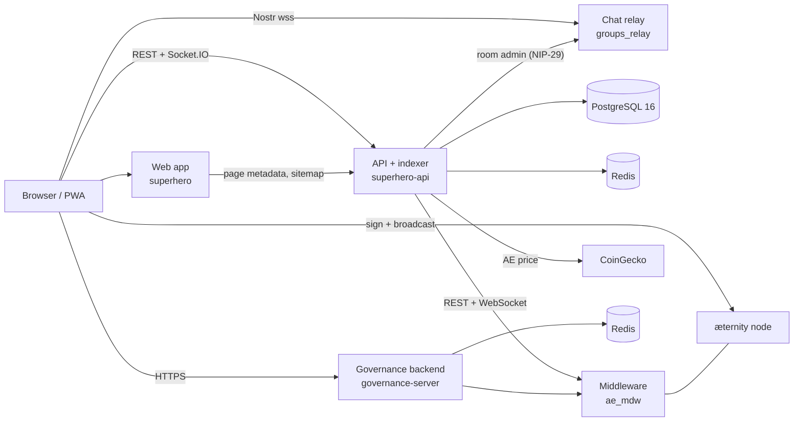

# Run Your Own Superhero

The web app, the API and the services they run with are open source, and the contracts they use
are public on æternity. You can run the whole stack under your own domain: the web app, the API and
its indexer, the chart history, the chat relay and the governance backend, on Superhero's public
contracts or your own.

This section walks through each service: what it does, how to configure it, and how to tell it is
healthy.

## The moving parts

| Service | Repository | What it does | Page |
| --- | --- | --- | --- |
| æternity node + middleware | `aeternity/ae_mdw` | Chain access and indexed transaction history | [Node, Middleware & Compiler](/self-hosting/chain-access) |
| API and indexer | `superhero-com/superhero-api` | Indexes the chain into Postgres; serves REST, Socket.IO, notifications and rewards | [API & Indexer](/self-hosting/api-and-indexer) |
| Chart history | part of the API | Token candles, DEX charts, portfolio history, AE price history, trending scores | [Charts & History](/self-hosting/chart-history) |
| Web app | `superhero-com/superhero` | The React app and its production server | [Web App](/self-hosting/web-app) |
| Chat relay | `verse-pbc/groups_relay` | Nostr relay for direct messages and token-gated community rooms | [Chat Relay](/self-hosting/chat-relay) |
| Governance backend | `aeternity/aepp-governance` | Stake-weighted poll results for `/voting` | [Governance Backend](/self-hosting/governance-backend) |
| Contracts | several | Posts, tokens, DAOs, DEX, identity links, governance | [Contracts](/self-hosting/contracts) |
| Keys and integrations | — | X, web push, mobile push, GIFs, payout wallets | [Keys & Integrations](/self-hosting/integrations) |

## Two ways to run it

**Your own front end on the shared network.** Build the web app for your domain and point it at
`https://api.superhero.com`. You get your own brand and domain on day one, with the same posts,
tokens and chat as superhero.com. Only [Web App](/self-hosting/web-app) applies.

**The full stack.** Run every service yourself. Your API indexes the chain into your own database,
so you control the data, the uptime and the features you switch on. You can keep using the public
contracts, which means your users share posts, tokens and liquidity with everyone on Superhero, or
deploy your own for a separate community. See [Contracts](/self-hosting/contracts).

## Order of bring-up

1. **Chain access.** Run `ae_mdw` (node and middleware in one container) from a snapshot, or start
   with the public endpoints. See [Node, Middleware & Compiler](/self-hosting/chain-access).
2. **Datastores.** PostgreSQL 16 and Redis for the API, plus a Redis for the governance backend.
3. **API and indexer.** Create the database schema once, start the API, and let the indexer
   backfill. See [API & Indexer](/self-hosting/api-and-indexer).
4. **Chat relay.** Run `groups_relay` behind TLS and give the API its admin key. See
   [Chat Relay](/self-hosting/chat-relay).
5. **Governance backend.** See [Governance Backend](/self-hosting/governance-backend).
6. **Web app.** Build for your domain and point it at the services above. See
   [Web App](/self-hosting/web-app).
7. **Keys and integrations.** Add the X app, web push keys and anything else you want to offer. See
   [Keys & Integrations](/self-hosting/integrations).
8. **Operations.** TLS renewal, backups, monitoring and the launch checklist. See
   [Operations](/self-hosting/operations).

## What to expect

- **The first backfill takes time.** The indexer walks the whole chain once. Posts and tokens
  appear first through fast pulls; trades and chart history fill in as the walk reaches them.
  Start from a node and middleware snapshot and run them on the same network as the API to keep
  this as short as possible.
- **One API instance is the simple setup.** The indexer, crons, sockets and payout queues are
  designed to run in a single process. See [Scaling](/self-hosting/operations#scaling).
- **Domain-bound features move with your domain.** Passkey wallets, the X OAuth callback and web
  push are tied to the domain they run on. See [Web App](/self-hosting/web-app#your-domain).

## Related

- [Architecture Overview](/concepts/architecture): how the contracts, indexer and clients fit together.
- [Deployed Addresses](/contracts/addresses): the public contracts on mainnet and testnet.
- [Networks & Endpoints](/aeternity/networks): the public æternity endpoints.
